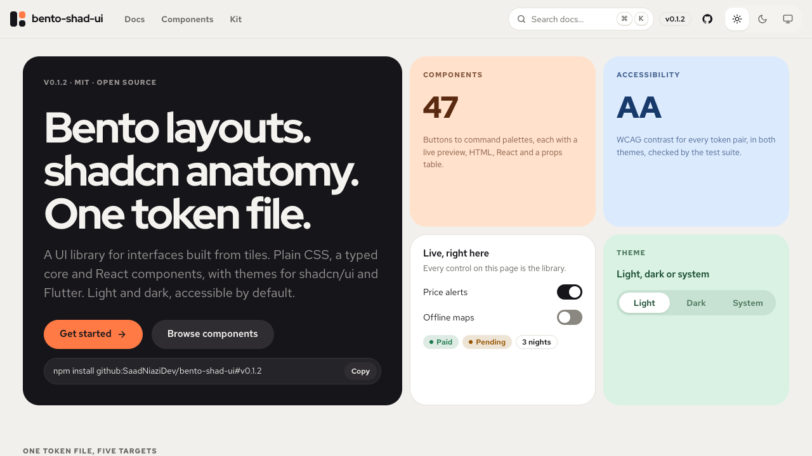
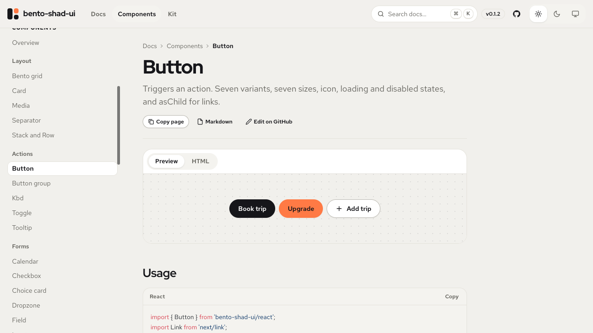

<div align="center">


# bento-shad-ui

**Bento layouts. shadcn anatomy. One token file.**

A UI library for interfaces built from tiles: plain CSS, a typed core and React components, with themes for shadcn/ui and Flutter. Light and dark, accessible by default.

[](https://github.com/SaadNiaziDev/bento-shad-ui/actions/workflows/ci.yml)
[](https://github.com/SaadNiaziDev/bento-shad-ui/releases)
[](https://saadniazidev.github.io/bento-shad-ui/)
[](https://saadniazidev.github.io/bento-shad-ui/docs/javascript-api/)
[](https://saadniazidev.github.io/bento-shad-ui/docs/accessibility/)
[](LICENSE)

[**Documentation**](https://saadniazidev.github.io/bento-shad-ui/) ·
[Components](https://saadniazidev.github.io/bento-shad-ui/docs/components/) ·
[Live kit](https://saadniazidev.github.io/bento-shad-ui/kit/) ·
[Changelog](CHANGELOG.md) ·
[llms.txt](llms.txt)

<br>

<picture>
  <source media="(prefers-color-scheme: dark)" srcset=".github/assets/hero-dark.png">
  
</picture>

</div>

## Features

- **47 components and 8 characters**: buttons, forms, calendar, OTP, tables, stats, charts, dialogs, sheets, menus, command palette, navbar, sidebar and bottom nav. Each has a [docs page](https://saadniazidev.github.io/bento-shad-ui/docs/components/) with a live preview, HTML, React usage and a generated props table.
- **Bento layout**: tiles span 1–4 columns and 1–3 rows. The grid follows its container's width through container queries, so the same markup works in a sidebar, a modal or a full page.
- **One token file, five targets**: framework-free CSS, a typed vanilla core, React components, a shadcn/ui + Tailwind v4 theme with registry items, and a Flutter theme.
- **shadcn-compatible tokens**: the same names (`--primary`, `--muted-foreground`…) plus brand, status, inverse and five tile tints, written in OKLCH.
- **Accessible**: WCAG AA contrast for every token pair in both themes, enforced by tests. Visible focus rings, full keyboard support, and native `<dialog>`, `popover` and `<details>` elements.
- **Typed and SSR-safe**: TypeScript source with declaration files. Nothing touches `window` at import time, and the React bundle is marked `"use client"`.
- **Pencil characters**: eight hand-drawn people and animals (Mira, Theo, Zara, Kofi, Pip, Dumpling, Biscuit, Moss), each with six moods, for empty states, errors, loading and success. They follow your tokens and turn to chalk in dark mode. [Meet the cast](https://saadniazidev.github.io/bento-shad-ui/docs/components/characters/).
- **Distinctive type**: Red Hat Display and Red Hat Text, with no monospace font anywhere.
- **Written for AI agents too**: `llms.txt`, `llms-full.txt` and a Markdown version of every docs page.

<p align="center"></p>

<p align="center"></p>

## Installation

```bash
npm install github:SaadNiaziDev/bento-shad-ui#v0.2.0
```

| Your stack | Use | Guide |
|---|---|---|
| Any HTML page | `bento-shad-ui/bento.css` + `bento-shad-ui/auto`, or the CDN files below | [HTML](https://saadniazidev.github.io/bento-shad-ui/docs/html/) |
| React, Next.js, Vite | `import 'bento-shad-ui/bento.css'` and `import { … } from 'bento-shad-ui/react'` | [React](https://saadniazidev.github.io/bento-shad-ui/docs/react/) |
| shadcn/ui + Tailwind v4 | `npx shadcn@latest add …/r/bento-theme.json --overwrite`, then `…/r/bento-grid.json` | [shadcn/ui](https://saadniazidev.github.io/bento-shad-ui/docs/shadcn/) |
| Flutter | Copy `dist/flutter/bento_theme.dart` into `lib/` | [Flutter](https://saadniazidev.github.io/bento-shad-ui/docs/flutter/) |

No build step:

```html
<link rel="stylesheet" href="https://cdn.jsdelivr.net/gh/SaadNiaziDev/bento-shad-ui@v0.2.0/dist/bento.min.css">
<script src="https://cdn.jsdelivr.net/gh/SaadNiaziDev/bento-shad-ui@v0.2.0/dist/bento.iife.min.js" defer></script>
```

Fonts: [Red Hat Display and Red Hat Text](https://fonts.google.com/?query=red+hat) (SIL OFL). The [installation guide](https://saadniazidev.github.io/bento-shad-ui/docs/installation/) covers Google Fonts, `next/font` and Flutter assets.

## Quick start

**React**

```tsx
import 'bento-shad-ui/bento.css';
import { BentoGrid, Tile, TileTitle, Button, Stat, toast } from 'bento-shad-ui/react';

export function Overview() {
  return (
    <BentoGrid>
      <Tile span={2} rows={2} tone="inverse">
        <TileTitle>Plan together</TileTitle>
        <Button variant="brand" onClick={() => toast({ title: 'Invite sent', variant: 'success' })}>Invite</Button>
      </Tile>
      <Tile tone="peach"><Stat label="Bookings" value="1,284" delta="+12.4%" trend="up" /></Tile>
      <Tile>Price alerts</Tile>
    </BentoGrid>
  );
}
```

**HTML**

```html
<body class="bk">
  <div class="bk-bento">
    <div class="bk-bento-grid">
      <article class="bk-tile bk-span-2 bk-row-2" data-tone="inverse">
        <h2 class="bk-h2">Plan together</h2>
        <button class="bk-button" data-variant="brand" data-bk-toast='{"title":"Invite sent"}'>Invite</button>
      </article>
      <article class="bk-tile" data-tone="peach">Offline maps</article>
      <article class="bk-tile">Price alerts</article>
    </div>
  </div>
</body>
```

## Documentation

| | |
|---|---|
| [Introduction](https://saadniazidev.github.io/bento-shad-ui/docs/getting-started/) | Concepts and which layer to use |
| [Installation](https://saadniazidev.github.io/bento-shad-ui/docs/installation/) | npm, CDN, shadcn registry, Flutter, fonts, troubleshooting |
| [Theming](https://saadniazidev.github.io/bento-shad-ui/docs/theming/) · [Typography](https://saadniazidev.github.io/bento-shad-ui/docs/typography/) · [Layout](https://saadniazidev.github.io/bento-shad-ui/docs/layout/) | Tokens, dark mode, rebranding, type scale, bento rules |
| [Components](https://saadniazidev.github.io/bento-shad-ui/docs/components/) | 47 pages with live previews and props tables |
| [JavaScript API](https://saadniazidev.github.io/bento-shad-ui/docs/javascript-api/) | Core functions, events, data attributes |
| [Accessibility](https://saadniazidev.github.io/bento-shad-ui/docs/accessibility/) | What's built in, and what's still your job |
| [AI agents](https://saadniazidev.github.io/bento-shad-ui/docs/ai-agents/) | `llms.txt`, `llms-full.txt`, and rules to paste into your CLAUDE.md |

The same guides live as Markdown in [`docs/`](docs).

## What's in the package

```
dist/
  bento.css, bento.min.css        tokens + components
  tokens.css, tokens.json         tokens only
  index.js, auto.js               vanilla core (ESM)
  bento.iife.js, .min.js          script-tag build (window.BentoUI)
  react.js                        React components (ESM, "use client")
  illustrations.js                pencil characters: renderCharacter(), characters, moods
  illustrations.iife(.min).js     script-tag build: draws every [data-bk-character]
  illustrations/*.svg             48 standalone SVGs (8 characters x 6 moods) + index.json
  types/                          TypeScript declarations
  shadcn-theme.css                globals.css for shadcn/ui + Tailwind v4
  flutter/bento_theme.dart        Flutter ThemeData + ThemeExtension
r/                                shadcn registry items
docs/                             guides (also on the website)
llms.txt, llms-full.txt           docs for AI agents
```

## Browser support

Current Chrome, Edge, Safari and Firefox. The library uses container queries, `color-mix()`, OKLCH, `:has()`, `<dialog>` and the `popover` attribute, all supported since 2024.

## Versioning

Semantic versioning. The public API is the class names, data attributes, token names, exported functions and React props. Until 1.0, minor releases may contain breaking changes, which are listed in the [changelog](CHANGELOG.md). Pin a tag in every install.

## Contributing

```bash
npm install
npm run check        # typecheck, build, test, docs site
npm run docs:serve   # http://localhost:4321/bento-shad-ui/
```

Source lives in `src/` (tokens, CSS, core, React) and `docs/`. Never edit `dist/`, `r/` or `llms-full.txt` by hand. See [CONTRIBUTING.md](CONTRIBUTING.md) and [AGENTS.md](AGENTS.md).

## License

MIT © Saad Ali Khan. Red Hat fonts: SIL Open Font License 1.1.
