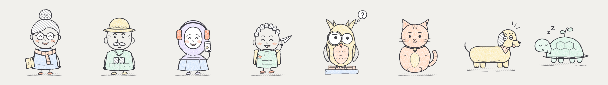

<div align="center">


# bento-shad-ui

**Bento layouts. shadcn anatomy. One token file.**

A UI library for interfaces built from tiles: plain CSS, a typed core, React components and hand-drawn pencil characters, with themes for shadcn/ui and Flutter. Light and dark, accessible by default.

[](https://www.npmjs.com/package/bento-shad-ui)
[](https://www.npmjs.com/package/bento-shad-ui)
[](https://github.com/SaadNiaziDev/bento-shad-ui/actions/workflows/ci.yml)
[](https://saadniazidev.github.io/bento-shad-ui/)
[](https://saadniazidev.github.io/bento-shad-ui/docs/javascript-api/)
[](https://saadniazidev.github.io/bento-shad-ui/docs/accessibility/)
[](https://github.com/SaadNiaziDev/bento-shad-ui/blob/main/LICENSE)

[**Documentation**](https://saadniazidev.github.io/bento-shad-ui/) ·
[Components](https://saadniazidev.github.io/bento-shad-ui/docs/components/) ·
[Characters](https://saadniazidev.github.io/bento-shad-ui/docs/components/characters/) ·
[Live kit](https://saadniazidev.github.io/bento-shad-ui/kit/) ·
[Changelog](https://github.com/SaadNiaziDev/bento-shad-ui/blob/main/CHANGELOG.md) ·
[llms.txt](https://saadniazidev.github.io/bento-shad-ui/llms.txt)

<br>

<picture>
  <source media="(prefers-color-scheme: dark)" srcset="https://raw.githubusercontent.com/SaadNiaziDev/bento-shad-ui/main/.github/assets/hero-dark.png">
  
</picture>

</div>

## Install

```bash
npm install bento-shad-ui
```

<sub>Or `pnpm add bento-shad-ui`, `yarn add bento-shad-ui`, `bun add bento-shad-ui`.</sub>

| Your stack | Use | Guide |
|---|---|---|
| Any HTML page | `bento-shad-ui/bento.css` + `bento-shad-ui/auto`, or the CDN files below | [HTML](https://saadniazidev.github.io/bento-shad-ui/docs/html/) |
| React, Next.js, Vite | `import 'bento-shad-ui/bento.css'` and `import { … } from 'bento-shad-ui/react'` | [React](https://saadniazidev.github.io/bento-shad-ui/docs/react/) |
| shadcn/ui + Tailwind v4 | `npx shadcn@latest add …/r/bento-theme.json --overwrite`, then `…/r/bento-grid.json` | [shadcn/ui](https://saadniazidev.github.io/bento-shad-ui/docs/shadcn/) |
| Flutter | Copy `dist/flutter/bento_theme.dart` into `lib/` | [Flutter](https://saadniazidev.github.io/bento-shad-ui/docs/flutter/) |

No build step? Use a CDN. jsDelivr and unpkg serve every npm version:

```html
<link rel="stylesheet" href="https://cdn.jsdelivr.net/npm/bento-shad-ui@0.2.1/dist/bento.min.css">
<script src="https://cdn.jsdelivr.net/npm/bento-shad-ui@0.2.1/dist/bento.iife.min.js" defer></script>
<!-- optional: draws every [data-bk-character] -->
<script src="https://cdn.jsdelivr.net/npm/bento-shad-ui@0.2.1/dist/illustrations.iife.min.js" defer></script>
```

Fonts: [Red Hat Display and Red Hat Text](https://fonts.google.com/?query=red+hat) (SIL OFL). The [installation guide](https://saadniazidev.github.io/bento-shad-ui/docs/installation/) covers Google Fonts, `next/font` and Flutter assets.

## Features

- **47 components**: buttons, forms, calendar, OTP, tables, stats, charts, dialogs, sheets, menus, command palette, navbar, sidebar and bottom nav. Each has a [docs page](https://saadniazidev.github.io/bento-shad-ui/docs/components/) with a live preview, HTML, React usage and a props table generated from the TypeScript source.
- **8 pencil characters, 6 moods each**: hand-drawn people and animals for empty states, errors, loading and success. They follow your tokens and turn to chalk in dark mode.
- **Bento layout**: tiles span 1–4 columns and 1–3 rows. The grid follows its container's width through container queries, so the same markup works in a sidebar, a modal or a full page.
- **One token file, five targets**: framework-free CSS, a typed vanilla core, React components, a shadcn/ui + Tailwind v4 theme with registry items, and a Flutter theme.
- **shadcn-compatible tokens**: the same names (`--primary`, `--muted-foreground`…) plus brand, status, inverse and five tile tints, written in OKLCH.
- **Accessible**: WCAG AA contrast for every token pair in both themes, enforced by tests. Visible focus rings, full keyboard support, and native `<dialog>`, `popover` and `<details>` elements.
- **Typed and SSR-safe**: TypeScript source with declaration files and JSDoc on every prop. Nothing touches `window` at import time, and the React bundle is marked `"use client"`.
- **Distinctive type**: Red Hat Display and Red Hat Text, with no monospace font anywhere.
- **Written for AI agents too**: `llms.txt`, `llms-full.txt` (both ship in the package) and a Markdown version of every docs page.

## Quick start

**React**

```tsx
import 'bento-shad-ui/bento.css';
import { BentoGrid, Tile, TileTitle, Button, Stat, toast } from 'bento-shad-ui/react';

export function Overview() {
  return (
    <BentoGrid>
      <Tile span={2} rows={2} tone="inverse">
        <TileTitle>Plan together</TileTitle>
        <Button variant="brand" onClick={() => toast({ title: 'Invite sent', variant: 'success' })}>Invite</Button>
      </Tile>
      <Tile tone="peach"><Stat label="Bookings" value="1,284" delta="+12.4%" trend="up" /></Tile>
      <Tile>Price alerts</Tile>
    </BentoGrid>
  );
}
```

**HTML**

```html
<body class="bk">
  <div class="bk-bento">
    <div class="bk-bento-grid">
      <article class="bk-tile bk-span-2 bk-row-2" data-tone="inverse">
        <h2 class="bk-h2">Plan together</h2>
        <button class="bk-button" data-variant="brand" data-bk-toast='{"title":"Invite sent"}'>Invite</button>
      </article>
      <article class="bk-tile" data-tone="peach">Offline maps</article>
      <article class="bk-tile">Price alerts</article>
    </div>
  </div>
</body>
```

## Pencil characters

<p align="center"></p>

| Character | Who | Good for |
|---|---|---|
| Mira | The planner, always one step ahead with a paper map | Onboarding, success, plans and schedules |
| Theo | The guide, unhurried and kind | Welcome screens, tips and help, guided tours |
| Zara | The connector, always on a call | Messages and chat, notifications, offline states |
| Kofi | The explorer, nine years old, folds a paper plane for every trip | Celebrations, first-run moments, achievements |
| Pip | The owl who has read everything | Empty states, search with no results, help and docs |
| Dumpling | The cat who knocks things off tables, then looks sorry | Errors, failed actions, undo prompts |
| Biscuit | The dachshund who sniffs out anything at nose height | 404 and not found, search, lost connections |
| Moss | The turtle who takes the scenic route | Loading, waiting and progress, slow connections |

Every character has six moods: `neutral`, `happy`, `surprised`, `sad`, `thinking`, `sleepy`.

```tsx
import { Empty, Button, PencilCharacter } from 'bento-shad-ui/react';

<Empty
  illustration={<PencilCharacter character="pip" mood="thinking" />}
  title="No trips yet"
  description="Trips you plan or get invited to show up here."
  actions={<Button>Plan a trip</Button>}
/>
```

Without React, add the illustrations script and a placeholder. Changing `data-mood` redraws it:

```html
<span data-bk-character="moss" data-mood="sleepy" data-size="140"></span>
```

`renderCharacter(id, mood)` from `bento-shad-ui/illustrations` returns an SVG string for servers and build scripts. The package also ships 48 standalone SVG files in `dist/illustrations/` for ``, Figma and Flutter. The [gallery](https://saadniazidev.github.io/bento-shad-ui/docs/components/characters/) has a live mood switcher.

## Documentation

| | |
|---|---|
| [Introduction](https://saadniazidev.github.io/bento-shad-ui/docs/getting-started/) | Concepts and which layer to use |
| [Installation](https://saadniazidev.github.io/bento-shad-ui/docs/installation/) | npm, CDN, shadcn registry, Flutter, fonts, troubleshooting |
| [Theming](https://saadniazidev.github.io/bento-shad-ui/docs/theming/) · [Typography](https://saadniazidev.github.io/bento-shad-ui/docs/typography/) · [Layout](https://saadniazidev.github.io/bento-shad-ui/docs/layout/) | Tokens, dark mode, rebranding, type scale, bento rules |
| [Components](https://saadniazidev.github.io/bento-shad-ui/docs/components/) | 47 pages with live previews and props tables |
| [Characters](https://saadniazidev.github.io/bento-shad-ui/docs/components/characters/) | The pencil cast, moods, and which character fits which moment |
| [JavaScript API](https://saadniazidev.github.io/bento-shad-ui/docs/javascript-api/) | Core functions, events, data attributes |
| [Accessibility](https://saadniazidev.github.io/bento-shad-ui/docs/accessibility/) | What's built in, and what's still your job |
| [AI agents](https://saadniazidev.github.io/bento-shad-ui/docs/ai-agents/) | `llms.txt`, `llms-full.txt`, and rules to paste into your CLAUDE.md |

<p align="center"></p>

The same guides live as Markdown in [`docs/`](https://github.com/SaadNiaziDev/bento-shad-ui/tree/main/docs), and ship in the npm package.

## What's in the package

| Import | File | What it is |
|---|---|---|
| `bento-shad-ui/bento.css` | `dist/bento.css`, `dist/bento.min.css` | Tokens and every component |
| `bento-shad-ui/tokens.css` | `dist/tokens.css` | Tokens only |
| `bento-shad-ui` | `dist/index.js` | Vanilla core: theme, toasts, popovers, tabs, command palette (ESM) |
| `bento-shad-ui/auto` | `dist/auto.js` | The core, started on import |
| `bento-shad-ui/react` | `dist/react.js` | React components (ESM, `"use client"`) |
| `bento-shad-ui/illustrations` | `dist/illustrations.js` | `renderCharacter()`, `characters`, `moods` |
| `bento-shad-ui/illustrations/*` | `dist/illustrations/*.svg` | 48 standalone character SVGs and `index.json` |
| `bento-shad-ui/shadcn-theme.css` | `dist/shadcn-theme.css` | `globals.css` for shadcn/ui + Tailwind v4 |
| `bento-shad-ui/tokens.json` | `dist/tokens.json` | Raw tokens for other tools |
| `bento-shad-ui/flutter/bento_theme.dart` | `dist/flutter/bento_theme.dart` | Flutter `ThemeData` + `ThemeExtension` |
| `bento-shad-ui/llms-full.txt` | `llms-full.txt` | Every guide in one file, for AI agents |
| `<script>` tag | `dist/bento.iife.min.js`, `dist/illustrations.iife.min.js` | `window.BentoUI` and `window.BentoIllustrations` |

TypeScript declarations are in `dist/types/`. The shadcn registry items are in `r/`.

## Browser support

Current Chrome, Edge, Safari and Firefox. The library uses container queries, `color-mix()`, OKLCH, `:has()`, `<dialog>` and the `popover` attribute, all supported since 2024.

## Versioning and releases

Semantic versioning. The public API is the class names, data attributes, token names, exported functions and React props. Until 1.0, minor releases (0.x.0) may contain breaking changes, which are listed in the [changelog](https://github.com/SaadNiaziDev/bento-shad-ui/blob/main/CHANGELOG.md). The `^0.x.y` range that `npm install` writes only accepts patch releases while the version is below 1.0, so updates never surprise you.

Releases are published to npm from GitHub Actions with [provenance](https://docs.npmjs.com/generating-provenance-statements), so each version on npm links back to the commit and workflow that built it.

## Contributing

```bash
git clone https://github.com/SaadNiaziDev/bento-shad-ui.git && cd bento-shad-ui
npm install
npm run check        # typecheck, build, test, docs site
npm run docs:serve   # http://localhost:4321/bento-shad-ui/
```

Source lives in `src/` (tokens, CSS, core, React, illustrations) and `docs/`. Never edit `dist/`, `r/` or `llms-full.txt` by hand. See [CONTRIBUTING.md](https://github.com/SaadNiaziDev/bento-shad-ui/blob/main/CONTRIBUTING.md) and [AGENTS.md](https://github.com/SaadNiaziDev/bento-shad-ui/blob/main/AGENTS.md).

## License

MIT © Saad Ali Khan. The pencil characters are original artwork under the same license. Red Hat fonts: SIL Open Font License 1.1.
